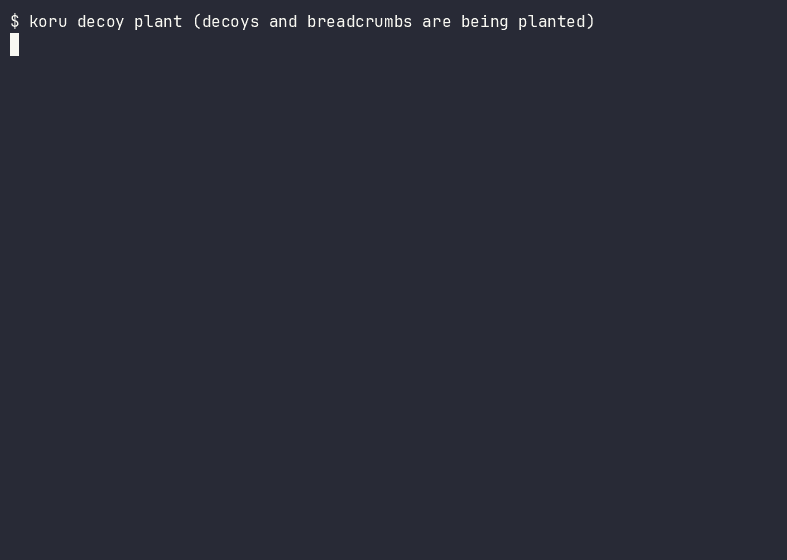
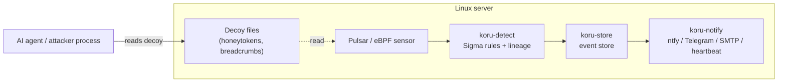

<p align="center">
  <picture>
    <source media="(prefers-color-scheme: dark)" srcset="docs/assets/koru-logo-dark.svg">
    <source media="(prefers-color-scheme: light)" srcset="docs/assets/koru-logo-light.svg">
    
  </picture>
</p>

<p align="center">
  <strong>Deception-first runtime defense for the AI era: trap AI attack agents, catch hijacked AI agents.</strong>
</p>

<p align="center">
  <a href="https://github.com/korusecurity/koru/actions/workflows/ci.yml"></a>
  <a href="https://github.com/korusecurity/koru/releases"></a>
  <a href="LICENSE"></a>
</p>

Koru is a deception-based runtime security tool for Linux servers. It plants
honeytokens (decoy credentials, fake SSH keys, decoy `.env` files, fake MCP
configuration files and AI-bait notes) and detects access to them at the
kernel level with eBPF, before any credential is used. When something reads a
decoy, Koru traces the accessing process through its process lineage and
reports whether the reader looks like a human, an AI agent, or a possibly
hijacked AI agent, for example an MCP server or coding assistant driven by
prompt injection. The current version is 0.1.0; what Koru does and does not
do is stated in [What Koru is not](#what-koru-is-not).



*Demo scenario, recorded with asciinema in the lab VM from the current code:
an AI agent process reads a decoy SSH private key. Koru reports the rule
`decoy_ssh_key`, the actor type `ai_agent` and the ATT&CK technique
T1552.004. Steps: `koru decoy plant` plants the decoy files, the agent reads
`/home/devops/.ssh/id_ed25519_ci`, and Koru prints the finding. Scenario
script: [`lab/scripts/demo.sh`](lab/scripts/demo.sh).*

## Why Koru

1. **Access detection before credential use.** Most honeytoken tools alert
   when a decoy credential is *used* somewhere else (for example when a fake
   AWS key is presented to AWS). Koru alerts when the decoy file is *read* on
   the server itself, at kernel level via eBPF — before the credential can be
   used at all. See the honest comparison below for how
   use-detection tools differ.
2. **AI-agent attribution through process lineage.** Koru inspects the
   accessing process and its ancestors and reports whether the reader is a
   known AI agent signature (Claude Code, Codex, Cursor, Gemini CLI, MCP servers and
   others in [`packages/agents/`](packages/agents/)) — including a
   "possibly hijacked agent" class when a decoy read comes from an agent
   process tree. In the end-to-end suite, 40/40 AI-agent-context accesses
   were detected and attributed; overall 100/100 attack scenarios were caught
   with 0 false positives on the legitimate workload
   ([`docs/reports/metrics.md`](docs/reports/metrics.md)).
3. **Managed decoy lifecycle under Apache-2.0.** Decoys are data files (TOML
   templates in [`packages/decoys/`](packages/decoys/)), not code: anyone
   can add a decoy type without writing Rust. Each decoy is generated
   uniquely per server, integrity-checked, and cleanly removed by
   `koru decoy uninstall`. The whole tool is Apache-2.0 licensed; event data
   stays on the server and no telemetry is sent.

## How it works

Koru runs inside the Linux server — the place edge tools cannot see. Local
stdio MCP servers, for example, produce no network traffic for a network
sensor to inspect; Koru watches file access on the host instead.



- **Decoys and breadcrumbs.** Classic decoys (fake SSH private key, `.env`,
  `~/.aws/credentials`, fake database dump) plus AI-era decoys: fake LLM
  provider API keys (against LLMjacking), fake MCP configuration files
  (`.mcp.json`, `claude_desktop_config.json`, `~/.cursor/mcp.json`) with fake
  tokens, and AI-bait documentation notes. Breadcrumbs (fake
  `~/.bash_history`, `~/.ssh/config`, `known_hosts` entries) point to decoys;
  reading them is a separate signal.
- **Detection.** Pulsar (eBPF) reports file access; `koru-detect` evaluates
  Sigma-compatible rules ([`packages/rules/`](packages/rules/)) and
  classifies the actor from the process lineage. Self-protection rules treat
  stopping Koru, or modifying its binary, configuration, decoys or event
  store, as threat events.
- **Response.** Findings are stored locally and notified within
  seconds (end-to-end suite measurement: notification p95 1.06 s, CPU 1.12 % of total
  capacity, peak RSS 98.5 MB on the 4-vCPU lab VM;
  [`docs/reports/metrics.md`](docs/reports/metrics.md)). Isolating the
  attacker in a trap VM and terminating sessions are planned for later — see the
  roadmap.

## Quick start (60 seconds)

This verifies the decoy templates and plants, lists and removes decoys in a
throwaway directory. It does not install the agent or touch your real home
directory. Requires Rust (see `rust-toolchain.toml`) on Linux or macOS.

```bash
git clone https://github.com/korusecurity/koru.git
cd koru
cargo build --release --locked --bin koru
./target/release/koru decoy validate packages/decoys
TMP=$(cd "$(mktemp -d)" && pwd -P); mkdir -p "$TMP/home"
./target/release/koru decoy plant --package packages/decoys --root "$TMP/home" --state "$TMP/state"
./target/release/koru decoy list --state "$TMP/state"
./target/release/koru decoy uninstall --state "$TMP/state"
```

Expected: validation ends with `Result: 13 templates, 13 passed, 0 failed`,
planting prints `Planting completed: 13 entries (10 decoys, 3 breadcrumbs)`
followed by one line per entry, the listing shows the same entries, and
uninstalling prints `REMOVED` for each path and `Result: uninstall completed`,
which leaves the `home` directory as it was. (`pwd -P` resolves the temporary
directory to its real path; on macOS, which only plants under the system
temporary directory, `/var/...` would otherwise be rejected.) For the full signed install
(`koru install` with signature and SHA-256 verification, systemd unit, agent),
see the documentation site and [`distribution/install.sh`](distribution/install.sh).

## ATT&CK coverage

18 Sigma rules cover 12 MITRE ATT&CK Enterprise v20.0 techniques, including
T1552.001 (Credentials In Files), T1552.004 (Private Keys), T1552.003 (Shell
History), T1005 (Data from Local System), T1018 (Remote System Discovery)
and self-protection techniques T1489, T1543.002, T1554, T1565.001, T1070 and
T1685. The full table is generated by `koru rule coverage` and lives in
[`docs/reports/attack-coverage.md`](docs/reports/attack-coverage.md); the
ATT&CK Navigator layer is
[`docs/reports/attack-layer.json`](docs/reports/attack-layer.json).

## Honest comparison: Thinkst, Canarytokens, Falco

| | Koru | Thinkst Canary | Canarytokens (Thinkst) | Falco |
|---|---|---|---|---|
| Where it runs | Inside the Linux server (host) | Appliance / VM on the network | No sensor; token hosted by you or canarytokens.org | Inside the Linux host / Kubernetes |
| Detection moment | Decoy file **read** on the host (eBPF) | Decoy service / file touched on the appliance | Decoy credential **used** (e.g. DNS, HTTP, AWS login) | Syscall rules match (generic runtime detection) |
| AI-agent focus | Yes: decoys for AI agents + lineage attribution | Yes (Agent Provocateur; vendor-reported) | Yes: MCP config token since 2026-06-22 | No (Prempti adds agent tool-call hooks, experimental) |
| Decoy lifecycle (unique per host, integrity, clean removal) | Yes | Partial | No (tokens are standalone files) | No (not a deception tool) |
| Open source | Apache-2.0 | Canary closed; OpenCanary BSD-3 | GPL-3.0 (with Thinkst notes) | Apache-2.0 |
| Price | Free (open source) | ~$5,000–7,500 / year (public pricing) | Free | Free |

Koru does **not** replace Falco-style generic runtime detection, and Canarytokens is the
better choice if you only need a free token that alerts on use. Koru's claim
is narrower: host-level decoy-read detection plus AI-agent attribution.

## What Koru is not

- Not an EDR and not a network honeypot (for network deception see Beelzebub
  or Galah). Koru does not block attacks; it detects decoy access
  and notifies. An isolated trap VM and session termination
  are roadmap items, not current features.
- Not a prompt-injection detector: Koru sees the *result* (a decoy file
  read), not the injected prompt itself.
- No hack-back, ever. "Neutralising" a threat happens only inside Koru's own
  isolated environment in later releases.

## Architecture

Koru has four layers: a sensor (`koru-pulsar`) turns eBPF events into one shared event format
(`koru-event`), the core crates (`koru-detect`, `koru-decoy`, `koru-store`) detect, plant decoys and
persist events, and the outputs (`koru-notify`, export) deliver findings. Layers know only the
shared format, and CI enforces that rule with `cargo xtask dependency-check`. Every crate has its own
README under [`crates/`](crates/). See [docs/architecture.md](docs/architecture.md).

## Documentation

- Documentation site sources: [`docs-site/`](docs-site/) (`mdbook build docs-site`).
- Architecture: [`docs/architecture.md`](docs/architecture.md).
- Architecture decision records: [`docs/adr/`](docs/adr/).
- Threat model: [`docs/threat-model.md`](docs/threat-model.md).
- Measurements: [`docs/reports/metrics.md`](docs/reports/metrics.md).

## Roadmap

- **Available now:** workspace, decoys, detection, event store,
  notifications, end-to-end suite, hardened signed distribution.
- **Next:** isolated trap VM — breadcrumb targets resolve to an isolated
  environment; the real session is closed.
- **Later:** session termination and managed multi-server features.
- **Exploratory:** AI-assisted triage and product features.

## Community

- First response to issues within 48 hours, pull request review within one week.
- New decoy templates and detection rules need no Rust. Start with the
  issues labelled "good first issue".
- Conduct: [CODE_OF_CONDUCT.md](CODE_OF_CONDUCT.md). Governance:
  [GOVERNANCE.md](GOVERNANCE.md).
- Organization: <https://korusecurity.com>. General contact: contact@korusecurity.com.

## Contributing

See [CONTRIBUTING.md](CONTRIBUTING.md). It includes the decoy-template and
rule-package contribution guide (TOML decoys, Sigma rules, validation
commands). Contributions are accepted under the Developer Certificate of
Origin ([DCO](DCO)).

## Security

Report vulnerabilities privately to security@korusecurity.com. See
[SECURITY.md](SECURITY.md) for the disclosure policy, response targets and
scope. Do not open a public issue for a vulnerability.

## License

Apache-2.0. See [LICENSE](LICENSE). Third-party notices: [NOTICE](NOTICE).
