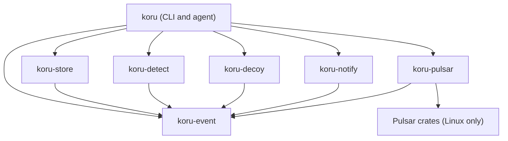

# Architecture

This document describes how Koru is built: the crates, the rules that keep them independent, the
event model, and the engineering constraints that apply to every change. Decisions with
trade-offs are recorded as architecture decision records in [`docs/adr/`](adr/), and the security
analysis lives in [`docs/threat-model.md`](threat-model.md).

## Overview

Koru is a deception and detection agent for Linux servers. It plants decoy files (honeytokens)
and breadcrumbs, watches file access with an eBPF sensor, evaluates the resulting events against
data-driven rules, stores them, and notifies the operator.

The data flows in one direction through four layers:

```text
Sensor (koru-pulsar) -> shared event format (koru-event)
                     -> core (koru-detect, koru-decoy, koru-store)
                     -> outputs (koru-notify, export)
```

- The **sensor** turns platform events into the shared event format. A new platform needs only a
  new sensor.
- The **shared event format** (`koru-event`) holds the event type, the schema version and the
  traits every layer implements. Layers talk to each other only through it.
- The **core** layers detect, plant decoys and persist events.
- The **outputs** deliver findings (notification channels, JSONL and OCSF export).

The only place where these layers are wired together is the `koru` crate, which builds the `koru`
command-line tool and the `koru-agent` binary.

## Crates and layers

The workspace (`Cargo.toml`) has seven product crates and one tool crate. Each crate has a single
responsibility.

| Crate | Layer | Responsibility | Allowed dependencies |
|---|---|---|---|
| `koru-event` | Shared format | Event schema v1, `Untrusted<T>` marker, IP masking, and the cross-layer traits (`Sensor`, `Detector`, `DecoyCatalog`, `EventStore`, `NotificationChannel`, `Heartbeat`) plus placeholders for later phases (`Router`, `ResponseAction`, `IntentClassifier`) | No Koru crate. External: serde, serde_json (tests), thiserror, uuid, time |
| `koru-pulsar` | Sensor | Embedded module that runs inside the Pulsar (Rust and eBPF) agent and translates Pulsar events into Koru events. The Pulsar-dependent code is compiled on Linux only | `koru-event`. The only crate allowed to depend on Pulsar |
| `koru-decoy` | Core | Decoys and breadcrumbs from TOML templates: validate, plant, list, integrity check and exact removal, with an integrity record | `koru-event` |
| `koru-detect` | Core | Sigma-compatible YAML rule packs, rule evaluator, process-lineage and AI-agent enrichment, actor-kind estimate, allowlist, self-protection events, ATT&CK mapping and Sigma export | `koru-event` |
| `koru-store` | Core | SQLite (WAL) event store with schema validation on entry, deduplication, JSONL and OCSF export, IP masking, retention and rotation, and the data quality report | `koru-event` |
| `koru-notify` | Output | ntfy, Telegram and SMTP channels, rate limiting, a persistent retry queue and Healthchecks.io heartbeats | `koru-event` |
| `koru` | Composition | The `koru` CLI and the `koru-agent` binary; the only crate that composes the layers | All Koru crates. Not directly dependent on Pulsar |
| `xtask` | Tooling | Repository automation such as `cargo xtask dependency-check`; not shipped | None |



The allowed external dependencies of every crate, each with a written rationale, are listed in
[`dependency-rules.toml`](../dependency-rules.toml).

## Layer independence

- Layers communicate only through the types and traits in `koru-event`. No layer knows another
  layer's internals.
- Only `koru-pulsar` depends on Pulsar. `koru-detect`, `koru-decoy`, `koru-store` and
  `koru-notify` know neither Pulsar, nor each other, nor the sensor. For example, the detection
  layer learns about watched paths through the `DecoyCatalog` trait without depending on
  `koru-decoy`.
- Every layer can be tested alone with a mock neighbor.
- The rule is enforced, not just documented: `cargo xtask dependency-check` reads
  `dependency-rules.toml` and `cargo metadata`, fails on any internal or external dependency that
  is not listed (including transitive Pulsar dependencies outside `koru-pulsar`), and runs in CI
  on every push and pull request.

## Event model and data quality

Every event follows schema v1 ([`schemas/event.v1.json`](../schemas/event.v1.json)), implemented
by the Rust types in `koru-event` with unknown fields rejected. The main fields are:

- Identity and time: `schema_version`, `event_id` (UUIDv7), `timestamp` (UTC, nanoseconds),
  `timestamp_trusted`.
- `source_tag`: `synthetic` (simulated attack), `legitimate` (normal workload) or `real`
  (production host). The tag comes from the installation configuration, never from event input,
  and the three kinds never mix: export refuses a store that holds more than one tag unless a
  source is chosen explicitly.
- `sensor`, `host`, `process` (including `lineage`), `container` (id and namespaces),
  `event_type` and `target`.
- `actor`: `kind` (`human`, `ai_agent` or `unknown`), a rationale and a confidence.
- `detection` (rule, decoy id, threat class, ATT&CK mapping) and `tags` (`intent`,
  `mitre_techniques`, `verified`) for future labelling.
- `session_id` and `response`, reserved for later releases.

Data quality rules:

- Every event is validated against the schema before it is stored. A corrupt, incomplete or
  untagged event never enters the store; it is rejected and counted by reason.
- Duplicates are removed. The deduplication key is a SHA-256 digest of the fields that define the
  observed fact; the event id and enrichment fields are excluded (ADR-0006).
- Fields an attacker can control (executable path, command line, environment, container
  attributes, target paths) are wrapped in the `Untrusted<T>` type and carry
  `x-koru-untrusted: true` in the JSON schema.
- Exports can mask IP addresses (IPv4 /24, IPv6 /48).
- `koru report data-quality` reports schema compliance, duplicates, untagged records and the
  number of rejected records.

### Timestamps

Timestamps are UTC with nanosecond precision and have exactly one canonical text form,
`YYYY-MM-DDTHH:MM:SS.nnnnnnnnnZ`, so that one instant cannot be written as two different strings
(which would defeat deduplication). The `timestamp_trusted` flag records whether the host clock
was NTP-synchronized. The agent reads it from `timedatectl` (`NTPSynchronized`) when it starts;
events produced while the clock is not synchronized carry `timestamp_trusted = false`.

## Decoys and breadcrumbs

- Decoys cover classic targets (an SSH private key, `.env` files, cloud credential files, a
  database dump) and AI-era targets (fake LLM provider keys, fake MCP configuration files with
  fake tokens, and notes written to attract AI agents).
- Decoys are valid in format, naturally timestamped and unique per host. Each has a UUIDv7 id, so
  the triggered decoy is known. Values are generated from a CSPRNG at install time and decoys
  never contain a real secret.
- Breadcrumbs (shell history, SSH config and `known_hosts` entries) point toward fake targets;
  reading them is a separate detection signal.
- Decoy definitions are data: TOML templates under `packages/decoys/`, validated against
  [`schemas/decoy-template.v1.json`](../schemas/decoy-template.v1.json). Adding a decoy type needs
  a template, not Rust code.
- Planting does not follow symlinks, does not overwrite existing files and takes a backup before
  appending. An integrity record (SHA-256, path, owner, mode, timestamp) lets Koru detect changes.
- Removal restores everything exactly and never deletes a decoy that was modified after planting;
  that case is reported instead.
- Access to a decoy from inside a container is detected as well.

## Detection quality and measurement

- Rules are data: Sigma v2.1.0-compatible YAML under `packages/rules/`, validated against
  [`schemas/rule-pack.v1.json`](../schemas/rule-pack.v1.json). Standard Sigma field names are used;
  Koru-specific derived fields carry the `koru.` prefix. Wildcards run on a linear, bounded
  matcher instead of a regex engine.
- Every rule maps to at least one MITRE ATT&CK technique. `koru rule coverage` produces a
  coverage table and an ATT&CK Navigator layer, and `koru rule export` writes Sigma YAML. The
  generated results are in [`attack-coverage.md`](reports/attack-coverage.md) and
  [`attack-layer.json`](reports/attack-layer.json).
- AI-agent awareness: AI agent processes are recognized by signatures under `packages/agents/`
  in the process lineage. Decoy access from such a lineage is classified as a suspected
  hijacked agent. The actor-kind estimate combines signatures, command timing and interactive
  shell evidence; its thresholds live in `thresholds.toml`, and every estimate carries a reason.
- Self-protection: Koru's own process is excluded only by the (executable path, inode, pid)
  triple, never by name. Stopping Koru, or changing its binary, configuration, store or decoys, is
  reported as a threat event.
- Golden datasets under `data/golden/` (synthetic and legitimate events) are replayed in CI, so
  rules are tested without a VM.
- Each release reports detection time, false-positive rate, ATT&CK coverage and catches by actor
  kind in [`docs/reports/metrics.md`](reports/metrics.md).

## Security

- The Koru crates declare `unsafe_code = "forbid"` at the workspace level; there is no unsafe
  code in Koru's own crates.
- `cargo audit` and `cargo deny check` run in CI. `deny.toml` covers licenses, advisories and
  banned dependencies. `Cargo.lock` is committed and builds use `--locked`. New dependencies
  must be justified in `dependency-rules.toml`.
- Clippy runs with `-D warnings`; `gitleaks` scans the full history in CI.
- Input from outside is fuzzed with cargo-fuzz (`fuzz/`): Pulsar event translation, configuration,
  decoy templates, rule packs, CLI input, JSONL import and the notification queue.
- The service runs under a hardened systemd unit (`distribution/unit.template`): no new
  privileges, a capability bounding set limited to what the sensor needs, a strict read-only
  file system apart from the state directory, a system call filter and restricted address
  families and namespaces.
- Releases are signed (ECDSA P-256 with SHA-256). `koru install` verifies the signature and the
  digests before anything is written, and an SBOM is produced with cargo-cyclonedx.
- TLS for notifications uses rustls only; server certificates and host names are always
  verified. Notification text is sanitized, and tokens never appear in logs, errors or debug
  output.
- Koru does not reveal itself to an attacker: the state directory lives outside the decoy root in
  a location that does not name Koru, and the service name is configurable.
- The STRIDE analysis is in [`docs/threat-model.md`](threat-model.md); vulnerability reporting
  is described in [`SECURITY.md`](../SECURITY.md).

## Performance and resilience

- Budgets: CPU below 2% of total capacity, resident memory below 100 MB, and under 5 seconds from
  decoy access to notification. Measurements are published in
  [`docs/reports/metrics.md`](reports/metrics.md).
- Resilience scenarios (`kill -9`, full disk, network outage, corrupt configuration) must either
  recover or raise an alarm, and are covered by tests.
- If a notification channel is unreachable, notifications go to a persistent queue and are
  retried with exponential backoff and jitter. The store has retention and a record cap.
- A failed upgrade health check rolls back automatically.
- CI builds and tests on x86_64 and arm64.

## Installation and lab

- Install, uninstall, upgrade and rollback are commands of the `koru` CLI. Removal reverts the
  decoys exactly, and an upgrade keeps the previous version for rollback.
- Configuration is a single TOML file; paths have no defaults and must be absolute and free of
  symlinks.
- The development lab is code: Lima definitions, scenario lists and scripts live in
  [`lab/`](../lab/), and `.devcontainer/` provides a contributor environment. Attack tools run
  only against the isolated lab VM, whose outbound traffic is closed
  (`distribution/egress-lock.nft`).
- User documentation is built with mdBook from [`docs-site/`](../docs-site/).

## Toolchain and versions

- Rust 1.99.0, pinned in `rust-toolchain.toml` with `clippy` and `rustfmt`; edition 2024, minimum
  supported version 1.99, Cargo resolver 3, and `rustfmt.toml` sets a width of 120.
- Pulsar is pinned to a commit on its main branch in `Cargo.toml` (ADR-0003 explains why a
  release was not used). Pulsar compiles on Linux only.
- Nightly Rust is used only for fuzzing; the product is never built with it.
- Data standards: Sigma specification v2.1.0, MITRE ATT&CK v20.0, OCSF 1.9.0.
- Tools used in CI are pinned: cargo-audit 0.22.2, cargo-deny 0.20.2, gitleaks 8.30.1.
- Exact dependency versions are in `Cargo.lock`; the release profile uses LTO and a single codegen
  unit.

## Repository layout

| Entry | Purpose |
|---|---|
| `crates/` | The seven product crates described above |
| `xtask/` | Repository automation, including `cargo xtask dependency-check` |
| `packages/` | Data files: decoy templates (`decoys/`), Sigma-compatible rules (`rules/`) and AI agent signatures (`agents/`) |
| `schemas/` | JSON schemas for events, decoy templates, rule packs and agent signatures |
| `data/` | Golden datasets (`golden/`) replayed in tests |
| `fuzz/` | cargo-fuzz targets and seed corpus (a separate workspace) |
| `lab/` | Lima VM definitions, attack scenarios and lab scripts |
| `distribution/` | Installer, signing and release scripts, systemd unit template, egress lock |
| `tools/` | Generators for reports, the ATT&CK catalog and the OCSF snapshot |
| `docs/` | `adr/` (decisions), `threat-model.md`, `reports/` (generated coverage and metrics) and `demo/` |
| `docs-site/` | mdBook sources of the user documentation |
| `.github/` | CI workflow, issue and pull request templates, labels, code owners |
| `.devcontainer/`, `.vscode/`, `.cargo/` | Contributor environment, editor tasks and the `cargo xtask` alias |
| `Cargo.toml`, `Cargo.lock`, `rust-toolchain.toml`, `rustfmt.toml` | Workspace, locked dependencies, pinned toolchain and formatting rules |
| `deny.toml`, `dependency-rules.toml`, `thresholds.toml` | Supply-chain policy, dependency matrix and detection thresholds (protected files; see [`CONTRIBUTING.md`](../CONTRIBUTING.md#protected-files)) |
| `.editorconfig`, `.gitattributes`, `.gitignore` | Editor, line-ending and ignore rules |
| `.env.example` | Example environment file; real secrets live only in `.env`, which is ignored |
| `README.md`, `CONTRIBUTING.md`, `CODE_OF_CONDUCT.md`, `GOVERNANCE.md`, `SECURITY.md`, `CHANGELOG.md` | Project and community documents |
| `LICENSE`, `NOTICE`, `DCO` | Apache-2.0 license, notices and the developer certificate of origin |
| `funding.json` | Funding metadata |
